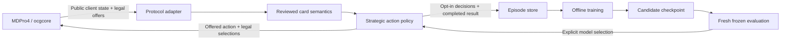

<div align="center">
  
  <h1>SKYNET</h1>
  <p><strong>Adaptive Duel Intelligence · MDPro4 AI Systems</strong></p>
  <p>Build a strategy. Change the deck. Learn from the duel.</p>
</div>

---

**SKYNET is an experimental, deck-independent duel AI for MDPro4.** It has its own
`SKYNET.exe`, solution, policy and learning tools. The project focuses on testing
and improving the AI's reliability, card coverage and playing strength across
different decks.

The first implementation is functional, with a deliberately bounded card library.
It is not yet a competitive general-purpose player or a trained neural model.
The revised direction is a general player that combines reusable expert knowledge,
situational planning and learned decisions. Custom deck profiles should improve
its play, not be required for every deck.

## Why a different AI

A deck-specific executor encodes one deck's route in ordered card handlers.
SKYNET instead compares the legal actions offered by the server using shared
card knowledge and strategic features. Changing a deck does not require a new
executor class. Knowledge added for a supported card is available to every deck.



The engine owns legality and resolution. SKYNET does not read an opponent's hidden
cards or assume it can execute a Lua effect in its head. The existing MDPro4 core
API has no state-clone primitive, so perfect lookahead is not silently assumed.

## Revised architecture: knowledge, plans and learning

The bootstrap currently scores individual actions and learns nine shared weights.
That is useful infrastructure, but it does not yet understand deck plans. Its
single-role-per-card table must evolve to represent multiple effects, costs,
targets, restrictions and follow-up choices.

The target design below is **planned**, not a description of shipped features:

| Layer | Responsibility |
| --- | --- |
| Card reference and representation | Load configured CDB text/base data and associate verified script/source evidence; represent effects so knowledge can transfer between cards |
| Reusable effect knowledge | Preserve reviewed executor decisions, prompt handling, targets, materials, restrictions and lifecycle state as shared modules |
| Situational strategy and planning | Choose goals from the board and resources, compare supported sequences, account for public threats and replan after interruption |
| Optional deck profiles | Let users customize goals, packages, priorities and routes without writing another large executor |
| Learned policy/value | Learn contextual action, target and route preferences from expert demonstrations and real duels |
| Protocol boundary | Execute only current legal offers and actual prompt candidates; keep hidden identities unavailable |

For example, a shared effect module knows that an effect discards a card and then
searches. The strategy layer decides which search completes a useful line and
which discard preserves follow-up. The planner compares that line with a safer
alternative. Learning can improve that comparison from outcomes. The next actual
server message remains authoritative if an interruption changes the position.

Broad card coverage needs both knowledge reuse and generalization. Card text and
script analysis can provide representations or propose modules, but do not prove
that costs, timing or rulings were interpreted correctly. Tested patterns can
transfer to other cards; unusual effects still need review. The goal is to reduce
manual work per card and remove mandatory per-deck programming, not to promise
perfect play of every unseen card. The current unknown-effect exclusion is a
bootstrap limitation, not the intended final architecture.

### Reuse existing executors without inheriting every bug

The local archive contains **83 executor source files**. The active shared
`DefaultExecutor` also retains useful tactical and lifecycle knowledge. Existing
code is a source of implementations, expert demonstrations and comparison
opponents; it is not automatically correct.

Prioritize recently maintained implementations with strong prompt/lifecycle
handling and measured results. Verify upstream history rather than copied file
timestamps. For example, upstream Labrynth and Swordsoul both received a
[September 2026 correction](https://github.com/IceYGO/windbot/commit/ba2f37cb1fa8bd53eab227970f4fd0a692a91fe6),
and Albaz received an
[August 2026 redirect-check update](https://github.com/IceYGO/windbot/commit/5b01279577eadfe513e1428ff7f263c6c29fb0eb).
Those dates describe upstream changes; they do not establish that our local copies
are identical or fully reviewed. Older code remains useful where its behavior is
verified. Review quality and observed play take precedence over age.

Two supported migration directions are intended:

- **Reviewed expert packs:** port a selected complete executor into an explicit
  compatibility mode, preserving its ordered decisions, callbacks and state.
  One decision owner must retain the subsequent prompts. This can preserve expert
  play while shared modules are developed.
- **Shared effect modules:** move complete behavior, including its dependencies
  and resets, into a pure proposal / commit / prompt interface. Keep deck goals
  separate so the same effect knowledge works across deck lists.

Never call arbitrary legacy `bool` handlers as competing scores. They can mutate
state or queue selections even when returning false. The Swordsoul boss-selection
sequence, for example, accumulates candidates through several ordered handlers.
Blind extraction would change its meaning. Expert demonstration data likewise
needs quality checks; imitation must not turn a known bug into a training target.

[`Catalog/executor-sources.json`](Catalog/executor-sources.json) now indexes the
83 archived files and the shared helper, with hashes, registration-line excerpts
and overridden hooks. Every entry is marked `source-only` and `unreviewed`.
This is a lexical index, not dependency analysis or a runtime card catalog.
The ignored archive is needed to follow those local source references.

To generate a fresh index at a new output path:

```powershell
python Tools/Skynet/catalog_sources.py `
  --executor-dir LegacyWindBot/Game/AI/Decks `
  --shared-source Game/AI/DefaultExecutor.cs `
  --output Artifacts/catalog-review.json
```

The tool reads only explicitly selected workspace sources, caps file count/size,
does not search archives/parents/siblings and never runs the indexed code.

### Friendly strategy authoring

The planned workflow is: import a `.ydk`, see available effect support and gaps,
choose reusable packages, adjust goals/priorities, run a test and inspect choices.
A future visual editor should produce the same validated profile format. Advanced
contributors can still implement unusual mechanics in C#.

This is an illustrative profile, **not a format loaded by the current binary**:

```json
{
  "name": "My Resonator Deck",
  "deck": "my-resonators.ydk",
  "knowledge": ["common-staples", "resonator-core"],
  "firstPlayerGoal": "establish-interruption",
  "secondPlayerGoal": "clear-threats-and-find-lethal",
  "searchPriority": ["missing-starter", "missing-combo-piece", "follow-up"],
  "preserve": ["unused-interruption", "next-turn-starter"]
}
```

Those choices must refer to implemented capabilities. A goal name alone does not
teach the engine how to achieve it. A deck without a profile should still use the
general policy and shared knowledge.

### RDA planner audit

The supplied Desktop RDA executor and the archived Crimson King executor differ.
Static inspection found useful card/state models, action transitions, route
search, end-board evaluation and replanning against actual observations. These are
strong design references; their simplified transitions are not an ocgcore clone.

| Reported concern | Desktop copy | Newer archived copy |
| --- | --- | --- |
| Script discovery and ZIP reads | Broad ancestor/sibling discovery and unbounded reads under a shared lock | Adds size/count/read caps and explicit `SCRIPTZIP`; unconfigured ancestor/sibling discovery still remains |
| Shared card models | Non-atomic publication and live properties cached globally | Adds locked publication, base CDB properties and per-state dynamic overrides |
| Memory persistence | Failed appends can discard pending records; concurrent compaction | Adds mutex/retry/atomic replacement; mutex-creation failure still permits an uncoordinated fallback |
| Background searches | Dropped tasks continue; deadline checked after a depth | Adds cancellation and a search gate; gate waits and some alternative/synchronous searches remain outside the complete budget |

These are source findings, not reproduced race failures or a measured strength
result. RDA memory records correlations around bad outcomes; it is not a learned
rules engine. Its regex script tags are useful hints, not trusted effect models.

Any port must use explicitly configured inputs, immutable shared definitions,
instance-owned duel state, reliable bounded persistence and one deadline covering
queueing plus all planning phases. Preserve SKYNET's unique completed episode
files. Bring over useful fixed-hand/model fixtures, then separately verify actual
engine behavior and concurrent duels.

## What works now

| Capability | Current behavior |
| --- | --- |
| Arbitrary `.ydk` input | One policy, without a deck executor or prior deck training |
| Main-phase decisions | Rank all offered summons, sets, position changes, supported effects and phase exits |
| Chaining | Rank optional offers; always honor mandatory offers |
| Card selection | Select from actual server candidates using hint and the correct activation/resolution context |
| Basic combat | Reuses observed-state battle helpers |
| Strategy | Development, pressure, advantage, interaction, recovery, protection, conservation, risk and modest race cohesion |
| Learning | Optional softmax exploration; completed-duel episodes; offline linear residual updates |
| Frozen play | Greedy inference; no training-file writes or automatic checkpoint promotion |
| MDPro4 | Optional Windows external opponent through the ocgcore Solo adapter |

The bootstrap library covers Pot of Greed, Raigeki, Dark Hole, Monster Reborn,
Mystical Space Typhoon, Mirror Force, Trap Hole, Fissure, Smashing Ground,
Reinforcement of the Army and Sangan. Prompt timing was checked against local
`ygopro-scripts` sources. Mandatory selections do not depend on an activation
handler having run.

**Unfamiliar cards have limits.** Basic monster play can work, but unknown optional
effects are declined. General extra-deck procedure planning, complex combos and
unreviewed effect target/option choices are not solved. The included Vanguard
starter is an unrestricted research deck, not a current tournament-format deck.

## Build and run

Windows prerequisites: Visual Studio/MSBuild with .NET Framework 4.8 targeting
support. This is a classic C# project, not an SDK project. Python 3.11+ is needed
only for the development tools.

```powershell
msbuild Skynet.sln /t:Build /p:Configuration=Release /p:Platform="Any CPU"
.\bin\Release\SKYNET.exe --help
.\bin\Release\SKYNET.exe "DeckFile=Decks/AI_Skynet.ydk" `
  "DbPath=D:/YourGame/Data/locales/en-US/cards.cdb" `
  Host=127.0.0.1 Port=7911 Version=4962 Chat=false
```

The duel host must already be listening. Runtime databases and game scripts are
provided by the game and are not shipped in this repository. Missing input files
or a failed connection return a nonzero process exit code.

Useful options: `Name`, `DeckFile`, `DbPath`, `Host`, `Port`, `HostInfo`, `Version`,
`Hand`, `Debug`, `Chat`, `Config`, `PolicyModel`, `PolicyTraining`, `PolicyData`,
`PolicySeed`, and `PolicyGroup`. Chat is off by default. The optional `Deck=SKYNET`
argument used by MDPro4 identifies this policy; it does not select a legacy deck AI.

## Install into MDPro4

The game checkout needs the corresponding `SoloSelector.Skynet` host adapter and
its three call sites. The adapter source is mirrored in
[`Tools/Skynet/SoloSelector.Skynet.cs`](Tools/Skynet/SoloSelector.Skynet.cs).
This task installs those changes in the companion MDPro4 checkout; copying only
an executable into an older game build does not add the menu integration.

```powershell
.\Tools\Skynet\Install-MDPro4.ps1 -GameRoot 'D:/YourGame' -Configuration Release
```

This copies an explicit payload into `Data/Skynet`. Select **ocgcore**, then
**SKYNET** in Solo and choose the opponent's deck. The adapter uses the game's
locale database, disables training for normal play, and owns the exact external
process through completion, connection replacement, destruction and application
exit. It does not replace native Master Duel CPU behavior. Windows is the initial
integrated platform; other platform packaging remains future work.

## Can it teach itself?

It can learn **preferences among supported legal actions**. It does not learn new
card rules, target selection, battle tactics or combo procedures from these
weights. Those require richer representations and further implementation.

```powershell
# Collect completed episodes against a running duel host.
.\bin\Release\SKYNET.exe "DbPath=D:/YourGame/Data/locales/en-US/cards.cdb" `
  "DeckFile=Decks/AI_Skynet.ydk" Host=127.0.0.1 Port=7911 `
  PolicyTraining=true PolicyData=Training PolicySeed=42 `
  PolicyGroup=vanguard-vs-dragon

# After collecting varied deck/encounter cohorts from the SAME source model:
python Tools/Skynet/train.py --episodes Training --output Models/local/candidate-001.json

# Evaluate fresh matches with training disabled and PolicyModel=<candidate path>.
python Tools/Skynet/evaluate.py Artifacts/evaluation/results.csv
```

Training uses an episodic policy-gradient update over nine bounded features.
Checkpoint formats and features are validated; incomplete/disconnected duels do
not become losses. Each completed episode is published atomically under a unique
name. The offline trainer refuses mixed behavior-model versions, duplicate
records, invalid values and an empty training/holdout partition. Use stable,
distinct deck/encounter `PolicyGroup` values, not a different label for every duel.
Held-out groups do not contribute to the update. Candidate files never overwrite
a live checkpoint. Promotion is a separate, explicit choice after fresh frozen
duels; a small training win count is not evidence of improvement.

## Validation

```powershell
msbuild Tests/Skynet.Tests.csproj /p:Configuration=Debug
.\Tests\bin\Debug\Skynet.Tests.exe 'D:/YourGame/Data/locales/en-US/cards.cdb'
python Tools/Skynet/test_learning.py

python Tools/Skynet/native_smoke.py `
  --server 'D:/YourGame/Assets/Plugins/Windows/ygoserver.dll' `
  --data-root 'D:/YourGame/Data' --bot-exe bin/Release/SKYNET.exe `
  --deck Decks/AI_Skynet.ydk --opponent-deck Decks/AI_Skynet.ydk `
  --games 2 --output-dir Artifacts/qa/my-run
```

The native fixture requires an existing compatible Windows server DLL. It runs
isolated server/client processes with deadlines, records authoritative seats and
results, and checks normal retirement. It disables deck checks and shuffling for
a bounded smoke test. The core RNG seed is unavailable through this server API;
`PolicySeed` controls only policy sampling. Results with unknown core seeds are
reported as such, with independent match IDs.

Current checks: Debug and Release builds; 14 C# regression cases; 8 Python tests;
four prototype native duels, including supported effects and terminal training
records; two final Release starter duels with authoritative results and normal
exits; and 11 Unity host launch/connection-retirement assertions. The Unity
fixture preserved the checked settings and released its exact process. A separate
Play-session warning reported a common-menu sound loading timeout; the SKYNET
fixture itself logged no warnings or errors. These are correctness checks, not a strength benchmark.
Without a database, the C# harness explicitly skips its five card-backed cases.

## Testing and improvement roadmap

The next implementation milestone is one complete expert-to-shared-policy slice,
with a compatible comparison opponent and decision diagnostics. The source audit
and inventory above are complete; the following runtime work is planned:

1. **Choose reviewed expertise.** Compare local and recent upstream versions,
   record provenance, fix known defects and pin the exact baseline. Start with a
   staple package and a compact Swordsoul route; use Crimson King's planner as
   architectural input after its remaining resource issues are addressed.
2. **Preserve or port the complete behavior.** Introduce effect/prompt context and
   pure proposal/commit interfaces. Preserve a selected expert executor in a
   separately owned compatibility mode where appropriate. Port costs, selections,
   resets and restrictions together; do not splice stateful handlers into scoring.
3. **Make strategy configurable and observable.** Add the minimal validated profile,
   context-aware goals, a short supported plan and readable explanations. Test a
   changed deck list without another executor class. General play must not depend
   on a custom profile for every deck.
4. **Check equivalence and actual strength.** Test interrupted plans, multiple
   effects, mandatory prompts, moved source cards, rejected candidates leaving no
   state and simultaneous duels. Then compare against the pinned expert using
   real varied matches and both seats. Report coverage, failures, latency and
   per-matchup results. Keep fixed-order correctness fixtures separate.
5. **Learn from expertise and experience.** Collect public-state context, offered
   alternatives, actual actions/targets and completed outcomes. Use reviewed expert
   demonstrations to seed richer policy/value learning, then bounded exploration
   and fresh frozen evaluation on held-out decks/opponents. Nine global weights
   cannot express the full intended strategy system. Card/effect representations
   and generic prompt handling are prerequisites for stronger unseen-card play.

[WindBot Arena](https://github.com/mercury233/windbot-arena) is the preferred
evaluation integration to investigate: it already supports regression and
challenge experiments. Its current local launcher hardcodes `WindBot.exe` and
HTTP server mode; SKYNET currently runs one duel per process. The planned bridge
is a bounded, separately owned SKYNET service compatible with Arena's remote
endpoint mode, keeping the `SKYNET.exe` identity. This needs implementation and
verification against Arena's dedicated SRVPro; no Arena duel has run in this task.
See its [launcher source](https://github.com/mercury233/windbot-arena/blob/master/server/arena-service.js)
and [documented read-only results API](https://github.com/mercury233/windbot-arena/blob/master/API.md).

For the richer learning research, [YGO Agent](https://github.com/sbl1996/ygo-agent)
is a relevant implementation reference: it combines an engine environment with
learned agents and card-text embeddings. Its documentation still identifies
supported-card limits and unseen-card generalization as ongoing work. It has not
been integrated, benchmarked or adopted as a dependency here.

Each completed update gets a descriptive commit and its actual validation
results. The project scope is the duel AI and its MDPro4 integration; an Expedition
mode, progression economy and campaign content are outside this roadmap.

## Project map

- `Game/AI/Strategy/`: SKYNET policy, shared semantics, learning session and adapter.
- `Game/SkynetDecisionAdapter.cs`: legal-offer integration and terminal lifecycle.
- `Game/`, `YGOSharp.*`: protocol and client-visible duel state.
- `Tools/Skynet/`: training, evaluation, native QA and MDPro4 installation.
- `Tests/`: dependency-free .NET Framework regression harness.
- `Branding/`: project logo, caption and application icon.

## Credits

SKYNET reuses WindBot/YGOSharp transport, state handling and general battle helpers;
the original MIT attribution is retained in [LICENSE](LICENSE). Its build contains
no legacy specialized deck-executor collection or BotWrapper launcher. The old
workspace copy is preserved locally outside the build and publication payload.

Branding follows the SKYNET artwork supplied by the project owner. The caption
was edited with the built-in ImageGen tool to read **ADAPTIVE DUEL INTELLIGENCE**
and **MDPRO4 AI SYSTEMS**. These branding assets are separate from the inherited
source-code license. No card database, native game DLL or proprietary game artwork
is included in the repository.
