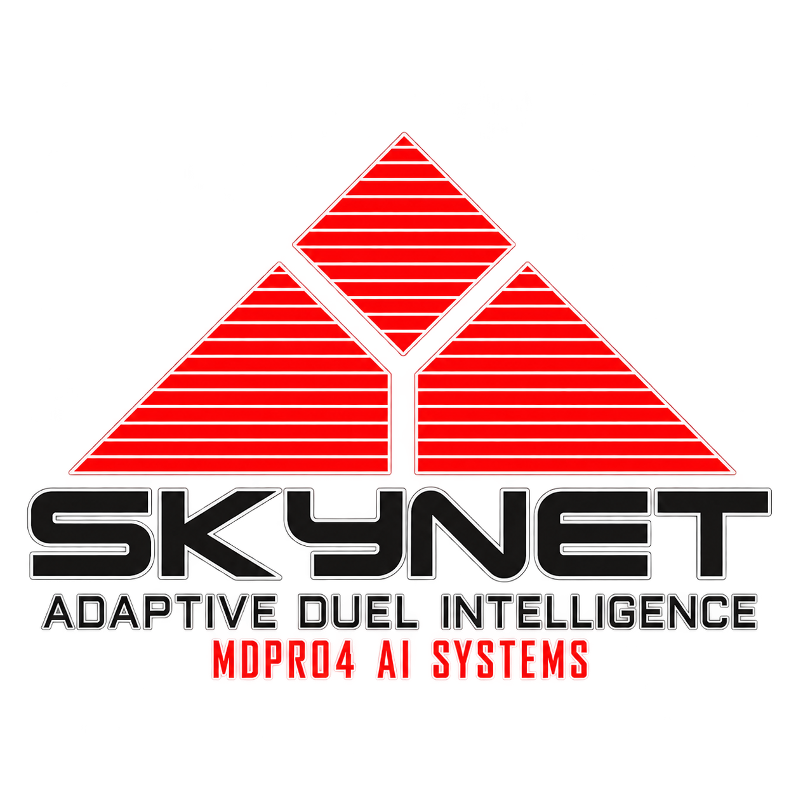
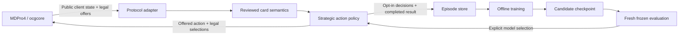

<div align="center">
  
  <h1>SKYNET</h1>
  <p><strong>Adaptive Duel Intelligence · MDPro4 AI Systems</strong></p>
  <p>Build a strategy. Change the deck. Learn from the duel.</p>
</div>

---

**SKYNET is an experimental, deck-independent duel AI for MDPro4.** It has its own
`SKYNET.exe`, solution, policy and learning tools. The project focuses on testing
and improving the AI's reliability, card coverage and playing strength across
different decks.

The first implementation is functional, with a deliberately bounded card library.
It is not yet a competitive general-purpose player or a trained neural model.
The revised direction is a general player that combines reusable expert knowledge,
situational planning and learned decisions. Custom deck profiles should improve
its play, not be required for every deck.

## Why a different AI

A deck-specific executor encodes one deck's route in ordered card handlers.
SKYNET instead compares the legal actions offered by the server using shared
card knowledge and strategic features. Changing a deck does not require a new
executor class. Knowledge added for a supported card is available to every deck.



The engine owns legality and resolution. SKYNET does not read an opponent's hidden
cards or assume it can execute a Lua effect in its head. The existing MDPro4 core
API has no state-clone primitive, so perfect lookahead is not silently assumed.

## Revised architecture: knowledge, plans and learning

The policy scores legal actions and can learn nine shared residual weights. The
shared Swordsoul module connects Emergence, Mo Ye, Taia, Longyuan, Chixiao and
Chengying, including costs, searches, materials and interruption. It re-evaluates observed resources
after each prompt. A second shared module covers the core Chimera searches,
two-material Fusions, graveyard protection and recovery. Neither module searches
simulated future states. The broader card
representation and configurable planning layers below remain work in progress.

The table describes the **target architecture**; the shipped subset is listed below:

| Layer | Responsibility |
| --- | --- |
| Card reference and representation | Load configured CDB text/base data and associate verified script/source evidence; represent effects so knowledge can transfer between cards |
| Reusable effect knowledge | Preserve reviewed executor decisions, prompt handling, targets, materials, restrictions and lifecycle state as shared modules |
| Situational strategy and planning | Choose goals from the board and resources, compare supported sequences, account for public threats and replan after interruption |
| Optional deck profiles | Let users customize goals, packages, priorities and routes without writing another large executor |
| Learned policy/value | Learn contextual action, target and route preferences from expert demonstrations and real duels |
| Protocol boundary | Execute only current legal offers and actual prompt candidates; keep hidden identities unavailable |

For example, a shared effect module knows that an effect discards a card and then
searches. The strategy layer decides which search completes a useful line and
which discard preserves follow-up. The planner compares that line with a safer
alternative. Learning can improve that comparison from outcomes. The next actual
server message remains authoritative if an interruption changes the position.

Broad card coverage needs both knowledge reuse and generalization. Card text and
script analysis can provide representations or propose modules, but do not prove
that costs, timing or rulings were interpreted correctly. Tested patterns can
transfer to other cards; unusual effects still need review. The goal is to reduce
manual work per card and remove mandatory per-deck programming, not to promise
perfect play of every unseen card. The current unknown-effect exclusion is a
bootstrap limitation, not the intended final architecture.

### Reuse existing executors without inheriting every bug

The local archive contains **83 executor source files**. The active shared
`DefaultExecutor` also retains useful tactical and lifecycle knowledge. Existing
code is a source of implementations, expert demonstrations and comparison
opponents; it is not automatically correct.

Prioritize recently maintained implementations with strong prompt/lifecycle
handling and measured results. Verify upstream history rather than copied file
timestamps. For example, upstream Labrynth and Swordsoul both received a
[September 2026 correction](https://github.com/IceYGO/windbot/commit/ba2f37cb1fa8bd53eab227970f4fd0a692a91fe6),
and Albaz received an
[August 2026 redirect-check update](https://github.com/IceYGO/windbot/commit/5b01279577eadfe513e1428ff7f263c6c29fb0eb).
Those dates describe upstream changes; they do not establish that our local copies
are identical or fully reviewed. Older code remains useful where its behavior is
verified. Review quality and observed play take precedence over age.

Two supported migration directions are intended:

- **Reviewed expert packs:** port a selected complete executor into an explicit
  compatibility mode, preserving its ordered decisions, callbacks and state.
  One decision owner must retain the subsequent prompts. This can preserve expert
  play while shared modules are developed.
- **Shared effect modules:** move complete behavior, including its dependencies
  and resets, into a pure proposal / commit / prompt interface. Keep deck goals
  separate so the same effect knowledge works across deck lists.

Two complete expert modes are implemented: `Agent=expert-oldschool` for the small
integration baseline and `Agent=expert-swordsoul` for a modern Swordsoul–Tenyi
comparison. Each retains one ordered decision owner, its callbacks and instance
state. The modern expert includes its upstream 40/15 deck and five focused fixes
to cost selection, resolution ownership and usage tracking. Its executor and
deck were verified against pinned upstream revision
`ba2f37cb1fa8bd53eab227970f4fd0a692a91fe6`.
The [review receipt](Catalog/expert-baselines.json) records source/script hashes,
corrections, 38 focused assertions and native completion fixtures. This is a
bounded review, not proof that every inherited branch is correct or optimal.

Expert mode is frozen and rejects `PolicyModel` and `PolicyTraining`. Exactly
one policy owns the whole duel's decisions and selection callbacks. Choosing a
different `.ydk` does not teach that expert additional cards.

Never call arbitrary legacy `bool` handlers as competing scores. They can mutate
state or queue selections even when returning false. The Swordsoul boss-selection
sequence, for example, accumulates candidates through several ordered handlers.
Blind extraction would change its meaning. Expert demonstration data likewise
needs quality checks; imitation must not turn a known bug into a training target.

[`Catalog/executor-sources.json`](Catalog/executor-sources.json) now indexes the
83 archived files and the shared helper, with hashes, registration-line excerpts
and overridden hooks. Every entry is marked `source-only` and `unreviewed`.
This is a lexical index, not dependency analysis or a runtime card catalog.
The ignored archive is needed to follow those local source references.

To generate a fresh index at a new output path:

```powershell
python Tools/Skynet/catalog_sources.py `
  --executor-dir LegacyWindBot/Game/AI/Decks `
  --shared-source Game/AI/DefaultExecutor.cs `
  --output Artifacts/catalog-review.json
```

The tool reads only explicitly selected workspace sources, caps file count/size,
does not search archives/parents/siblings and never runs the indexed code.

### Shared Swordsoul route and decision explanations

Use `DeckFile=Decks/AI_SkynetSwordsoul.ydk` with `Agent=skynet`. The included
40-card research deck has three Chixiao and three Chengying in its Extra Deck and uses the same
shared policy as other decks; it does not register a deck-specific executor.

The shared routes now include:

- **Emergence → Mo Ye or Taia → token + level-four Wyrm → Chixiao.** Mo Ye
  reveals an actual offered hand resource; Taia banishes a graveyard resource
  and mills at resolution. Chixiao searches follow-up or negates a visible enemy
  monster effect, subject to the core's shared once-per-turn restriction.
- **Longyuan + discard → token + level-six Wyrm → Chengying.** Longyuan's
  resolution-stage token choice and graveyard burn are handled separately.
  Chengying uses actual materials, can replace destruction by banishing an
  offered graveyard card, and handles its separate non-targeting field and
  graveyard banish selections.
- **Resource-aware searches and costs.** Preserve an unused starter where
  possible, prefer redundant discards, and stop searching an already committed
  extension. Actual legal offers remain authoritative after interruption.

The module checks current material properties and abandons unsupported routes
when resources disappear or change. Selection state belongs to the accepted
action and duel instance, never a static cache or a speculative proposal.

This is bounded shared coverage, not full Swordsoul/Tenyi play. Tenyi effects,
Blackout, Baronne and broader Extra Deck routes, flexible level manipulation and
Emergence's banished level change remain unsupported by the general policy.
After an additional normal summon becomes available, search preferences remain
conservative about starters already committed this turn.
The pre-summon reveal estimate cannot know whether a hand card is
already public; the core's actual activation and reveal offers remain decisive.
Reviewed executor and deployed-script provenance is in
[the existing review receipt](Catalog/expert-baselines.json).

Pass `Explain=true` to print the selected ranked action, up to four alternatives
and four excluded offers, their reasons, baseline/residual/total scores and the
policy revision. In **Arena → Settings → Agents**, enable **Decision explanations**
for the candidate, save, then click the visible **Candidate output** button beneath
the candidate address. The panel also has an **Open agent settings** shortcut.
Start a new duel after enabling explanations. The panel contains recent session
output; restarting Arena clears it, and selecting history does not reload old logs. Output
is capped at 128 decisions per duel and 480 characters per line. Hidden opponent
identities are redacted. Explanation reads do not sample RNG or queue selections;
2,200 paired seeded choices remained identical with diagnostics enabled.

These are explanations of the implemented scoring rules, not generated thoughts
or complete traces of every battle/selection callback. Default is off; expert
mode has no ranked-policy explanation. Fresh episodes now use `skynet-policy-v5`;
older episodes must be recollected, not relabeled. Learning is still optional
and offline, and this strategy update uses frozen built-in weights.

Validation for this expansion: Debug/Release Any CPU builds, 226 shared-route
and staple assertions, 38 expert assertions, 13 learning tests and 139 Arena
tests passed. Fixed-order native fixtures exercise both host seats and actual
cost, token, Synchro, burn and banish prompts. Frozen shuffled comparisons are
recorded below and in [the review receipt](Catalog/expert-baselines.json).
The earlier v3 compact-route result against v2 remains historical evidence in
that receipt; it is not a result for this expansion. No weights were trained or promoted.

The v4 expansion completed two new, shuffled comparisons:

| Opponent | Identical deck on both sides | Matches | SKYNET W–L | Recorded disconnects |
| --- | --- | ---: | ---: | ---: |
| Frozen v3 general policy | Expanded 40/6 research deck | 20 | 19–1 | 0 |
| Reviewed Swordsoul–Tenyi expert | Upstream 40/15 deck | 20 | 0–20 | 0 |

These are best-of-three **matches**, with frozen built-in weights and unknown
core RNG seeds. Approximate 95% Wilson intervals for SKYNET's match win rates
are 76.4–99.1% and 0–16.1%, respectively. Both host seats were exercised.
The first result supports added route coverage; the second shows the general
policy remains far behind the complete expert on the broader list.

The modern run completed 41 individual duels. Its explanations explicitly
decline unsupported Maxx "C", Impermanence, Called by the Grave, Veiler, Crossout,
Ecclesia and Tenyi effects. Repeated offer mentions are diagnostics, not distinct
missed opportunities or proof of each loss's cause. The practical next batch is
reusable interruption/protection handling, then Ecclesia/Tenyi and broader Extra
Deck routes, alongside complete demonstration capture for neural learning.
Learning weights cannot recover actions excluded by the current coverage gate.
No clients or native rooms remained after either experiment.

### Chimera as the second teaching deck

Use [`Decks/AI_SkynetChimera.ydk`](Decks/AI_SkynetChimera.ydk) with
`Agent=skynet` and `Explain=True`. This is a 40-card, six-card Extra Deck
diagnostic list with supported staples and simple filler; it is not a competitive
Fiendsmith list or a claim of current Master Duel banlist legality.

The initial teaching examples come from Drident's
[Chimera guide](https://www.masterduelmeta.com/articles/guides/chimera-drident)
and the supplied
[combo collection](https://www.masterduelmeta.com/combos-and-counters?combosDeckType=661816a0288bf27b775a21f3#combos):

- [Mirror opening](https://www.masterduelmeta.com/combo/6a1eb1cf58dfb7813369b373):
  recruit Big-Winged Berfomet, obtain Gazelle and Chimera Fusion, make King of
  Phantom Beasts, then prepare Coatl in the graveyard and recover Fusion.
- [Gazelle opening](https://www.masterduelmeta.com/combo/6a26974ad1e2883b1dd41a26):
  find the missing spell/material, make fusion Berfomet when the available races
  require it, and use its Deck-to-graveyard effect to establish protection.

The module works from actual hands, tracked own-deck counts and offered choices.
It changes searches when Fusion is already held, handles successive material
prompts, preserves a healthy boss, and can use a replacement Fusion when a
visible enemy effect targets it. Mirror and Coatl negates use the actual enemy
chain; random hand removal remains entirely the core's operation. Each reviewed
effect was checked against the deployed Lua script.

These are coded, reusable strategy rules available across deck lists. Combo
examples define desired behavior and regression cases; they are not a neural
training file that the bot automatically understands. The current learner can
adjust nine general action-scoring weights after completed duels. It cannot
invent missing effects or learn complete material/target strategies from those
weights. The separate demonstration recorder is groundwork for a richer model.

This first scope excludes Fiendsmith, Azamina, Hecahands, Guardian Chimera,
Chimera the Illusion Beast and Nightmare Apprentice effects. It does not yet
track a resolved Maxx "C" or Mulcharmy effect to optimize summon counts; the
linked low-summon lines serve as examples, not proof of hand-trap awareness.
An interrupted opener may correctly stop when no independent resources remain.

Validation: Debug and Release builds passed, alongside 335 focused C# 6
assertions (71 new Chimera checks). Six controlled native duels verified Mirror,
Coatl and Gazelle openings from both seats, including Monster Reborn resource
preservation. These fixed-order fixtures verify routes, not competitive strength.
Hashes, script provenance and scope are recorded in
[the validation catalog](Catalog/expert-baselines.json).

For Arena, add a **Chimera Core** deck profile pointing to this `.ydk`, select
**SKYNET · general policy**, and enable **Decision explanations**. Arena runs
frozen evaluation. Use **Candidate output** above the experiment controls to
inspect the chosen route and declined effects.

### Friendly strategy authoring

The planned workflow is: import a `.ydk`, see available effect support and gaps,
choose reusable packages, adjust goals/priorities, run a test and inspect choices.
A future visual editor should produce the same validated profile format. Advanced
contributors can still implement unusual mechanics in C#.

This is an illustrative profile, **not a format loaded by the current binary**:

```json
{
  "name": "My Resonator Deck",
  "deck": "my-resonators.ydk",
  "knowledge": ["common-staples", "resonator-core"],
  "firstPlayerGoal": "establish-interruption",
  "secondPlayerGoal": "clear-threats-and-find-lethal",
  "searchPriority": ["missing-starter", "missing-combo-piece", "follow-up"],
  "preserve": ["unused-interruption", "next-turn-starter"]
}
```

Those choices must refer to implemented capabilities. A goal name alone does not
teach the engine how to achieve it. A deck without a profile should still use the
general policy and shared knowledge.

### RDA planner audit

The supplied Desktop RDA executor and the archived Crimson King executor differ.
Static inspection found useful card/state models, action transitions, route
search, end-board evaluation and replanning against actual observations. These are
strong design references; their simplified transitions are not an ocgcore clone.

| Reported concern | Desktop copy | Newer archived copy |
| --- | --- | --- |
| Script discovery and ZIP reads | Broad ancestor/sibling discovery and unbounded reads under a shared lock | Adds size/count/read caps and explicit `SCRIPTZIP`; unconfigured ancestor/sibling discovery still remains |
| Shared card models | Non-atomic publication and live properties cached globally | Adds locked publication, base CDB properties and per-state dynamic overrides |
| Memory persistence | Failed appends can discard pending records; concurrent compaction | Adds mutex/retry/atomic replacement; mutex-creation failure still permits an uncoordinated fallback |
| Background searches | Dropped tasks continue; deadline checked after a depth | Adds cancellation and a search gate; gate waits and some alternative/synchronous searches remain outside the complete budget |

These are source findings, not reproduced race failures or a measured strength
result. RDA memory records correlations around bad outcomes; it is not a learned
rules engine. Its regex script tags are useful hints, not trusted effect models.

Any port must use explicitly configured inputs, immutable shared definitions,
instance-owned duel state, reliable bounded persistence and one deadline covering
queueing plus all planning phases. Preserve SKYNET's unique completed episode
files. Bring over useful fixed-hand/model fixtures, then separately verify actual
engine behavior and concurrent duels.

## What works now

| Capability | Current behavior |
| --- | --- |
| Arbitrary `.ydk` input | One policy, without a deck executor or prior deck training |
| Main-phase decisions | Rank all offered summons, sets, position changes, supported effects and phase exits |
| Chaining | Rank optional offers; always honor mandatory offers |
| Card selection | Select from actual server candidates using hint and the correct activation/resolution context |
| Basic combat | Reuses observed-state battle helpers |
| Strategy | Shared Swordsoul and core Chimera routes, searches, materials and protection, available across deck lists |
| Explanations | Opt-in chosen action, alternatives, exclusions and baseline/learned scores in console or Arena |
| Learning | Optional softmax exploration; completed-duel episodes; offline linear residual updates |
| Frozen play | Greedy inference; no training-file writes or automatic checkpoint promotion |
| MDPro4 | Optional Windows external opponent through the ocgcore Solo adapter |
| Expert comparison | Explicit `expert-oldschool` and `expert-swordsoul` modes with full executor lifecycles |
| Skynet Arena | English dashboard, deck-profile forms, native bounded SKYNET launches and WindBot comparison modes |
| YGO Agent research | Pinned source and bounded vocabulary/format inspection; no imported model inference yet |

The bootstrap library covers Pot of Greed, Raigeki, Dark Hole, Monster Reborn,
Mystical Space Typhoon, Mirror Force, Trap Hole, Fissure, Smashing Ground,
Reinforcement of the Army, Sangan, Hammer Shot, Double Summon, Swords of Revealing
Light and Dimensional Prison: **15 shared staple cards**. The separate shared
Swordsoul module adds six effect cards and their token/material handling; Chimera
adds seven effect cards covering the core King/Berfomet routes. Prompt timing was checked
against local `ygopro-scripts` sources; the four staple additions were also compared
with the deployed scripts. Mandatory selections do not depend on an activation
handler having run.

Those four shared staple behaviors reuse reviewed expert ideas across decks:

| Card | Shared behavior and boundary |
| --- | --- |
| Hammer Shot | Compare both fields' highest current ATK in face-up attack position; choose from the actual tied group at resolution |
| Double Summon | Prioritize the spell when two distinct low-level developments are currently offered and two main zones are free; post-normal and tribute-dependent routes remain unsupported |
| Swords of Revealing Light | Respond to a visible battle threat or facedown opposing monster; conserve another copy while an active one remains; MST recognizes its persistent Normal Spell behavior |
| Dimensional Prison | Respond to the observed attacker and conserve duplicate pending answers; the script targets automatically, so no target is preselected |

These are reviewed heuristics, not simulated future resolutions or a complete
immunity model. The policy does not call mutable expert predicates while scoring.

**Unfamiliar cards have limits.** Basic monster play can work, but unknown optional
effects are declined. General extra-deck procedure planning, complex combos and
unreviewed effect target/option choices are not solved. The included Vanguard
starter is an unrestricted research deck, not a current tournament-format deck.

## Build and run

Windows prerequisites: Visual Studio/MSBuild with .NET Framework 4.8 targeting
support. This is a classic C# project, not an SDK project. Python 3.11+ is needed
only for the development tools.

```powershell
msbuild Skynet.sln /t:Build /p:Configuration=Release /p:Platform="Any CPU"
.\bin\Release\SKYNET.exe --help
.\bin\Release\SKYNET.exe "DeckFile=Decks/AI_Skynet.ydk" `
  "DbPath=D:/YourGame/Data/locales/en-US/cards.cdb" `
  Host=127.0.0.1 Port=7911 Version=4962 Chat=false
```

The duel host must already be listening. Runtime databases and game scripts are
provided by the game and are not shipped in this repository. Missing input files
or a failed connection return a nonzero process exit code.

Useful options: `Name`, `Agent`, `DeckFile`, `DbPath`, `Host`, `Port`, `HostInfo`, `Version`,
`Hand`, `Debug`, `Chat`, `Config`, `PolicyModel`, `PolicyTraining`, `PolicyData`,
`PolicySeed`, and `PolicyGroup`. Chat is off by default. The optional `Deck=SKYNET`
argument identifies the SKYNET product. `Agent=skynet` is the default;
`Agent=expert-oldschool` and `Agent=expert-swordsoul` explicitly select the
included expert comparisons.

## Install into MDPro4

The game checkout needs the corresponding `SoloSelector.Skynet` host adapter and
its three call sites. The adapter source is mirrored in
[`Tools/Skynet/SoloSelector.Skynet.cs`](Tools/Skynet/SoloSelector.Skynet.cs).
This task installs those changes in the companion MDPro4 checkout; copying only
an executable into an older game build does not add the menu integration.

```powershell
.\Tools\Skynet\Install-MDPro4.ps1 -GameRoot 'D:/YourGame' -Configuration Release
```

This copies an explicit payload into `Data/Skynet`. Select **ocgcore**, then
**SKYNET** in Solo and choose the opponent's deck. The adapter uses the game's
locale database, disables training for normal play, and owns the exact external
process through completion, connection replacement, destruction and application
exit. It does not replace native Master Duel CPU behavior. Windows is the initial
integrated platform; other platform packaging remains future work.

## Can it teach itself?

It can learn **preferences among supported legal actions**. It does not learn new
card rules, target selection, battle tactics or combo procedures from these
weights. Those require richer representations and further implementation.

```powershell
# Collect completed episodes against a running duel host.
.\bin\Release\SKYNET.exe "DbPath=D:/YourGame/Data/locales/en-US/cards.cdb" `
  "DeckFile=Decks/AI_Skynet.ydk" Host=127.0.0.1 Port=7911 `
  PolicyTraining=true PolicyData=Training PolicySeed=42 `
  PolicyGroup=vanguard-vs-dragon

# After collecting varied deck/encounter cohorts from the SAME source model:
python Tools/Skynet/train.py --episodes Training --output Models/local/candidate-001.json

# Evaluate fresh matches with training disabled and PolicyModel=<candidate path>.
python Tools/Skynet/evaluate.py Artifacts/evaluation/results.csv
```

Training uses an episodic policy-gradient update over nine bounded features.
Checkpoint formats and features are validated; incomplete/disconnected duels do
not become losses. Each completed episode is published atomically under a unique
name. New episodes include `policyRevision: skynet-policy-v5`. The offline
trainer refuses missing or different policy revisions, mixed behavior-model
versions, duplicate records, invalid values and an empty training/holdout
partition. Recollect older episodes; do not relabel them. Existing compatible
weight files can still initialize fresh episodes under the current policy.
The candidate's provenance and identity include the policy revision. Use stable,
distinct deck/encounter `PolicyGroup` values, not a different label for every duel.
Held-out groups do not contribute to the update. Candidate files never overwrite
a live checkpoint. Promotion is a separate, explicit choice after fresh frozen
duels; a small training win count is not evidence of improvement.

## Path to a neural player

The current learner is a linear residual over nine features. A neural successor
would learn action preferences and outcome estimates from richer card, field,
chain and recent-action representations. It would keep the server's legal-choice
boundary and receive only information available to its player.

The proposed first target is a small specialist model trained from reviewed
executor demonstrations, followed by reinforcement learning against a pool of
frozen opponents and previous models. The existing executors provide teachers
and comparison opponents; they are not assumed to supply optimal labels. Training
and deployment remain separate, with no automatic promotion or self-editing code.

Before training, complete and validate observation and action encoding for the
chosen prompt coverage. The existing YGO Agent shadow mapper currently rejects
legal shuffle offers and cannot certify counter state; target, material and other
prompt families also need coverage. Running a model on an incomplete encoding
would make additional training an unreliable remedy. A first model may own a
clearly specified subset of decisions, with measured expert fallback elsewhere;
its evaluation must report that fallback rate.

There is no established SKYNET time-to-learn-per-deck. Measure decisions/second,
completed duels/hour, prompt coverage, illegal-response rate and frozen win-rate
curves on held-out encounters before projecting a training budget. A first
one-to-two-hour pilot is a proposed resource cap, not a promise of competence.
New combinations of supported cards may transfer existing knowledge; genuinely
new effects require representations, prompt support and validation before
retraining alone can help.

For scale, the pinned [YGO Agent training example](https://github.com/sbl1996/ygo-agent/blob/dbf5142d49aab2e6beb4150788d4fffec39ae3e5/README.md#single-gpu-training)
reports roughly 1,000 environment steps/second on a GTX 1650. Its short Blue-Eyes
run nearly beat random play every time but scored about 3% against a far more
extensively trained model. These are that project's reported results, not a
SKYNET benchmark or a forecast for another deck, GPU or engine.

## Validation

```powershell
msbuild Skynet.sln /t:Build /p:Configuration=Debug /p:Platform="Any CPU"
python Tools/Skynet/test_learning.py
python Tools/Skynet/test_ygo_agent_inspection.py
python Tools/Skynet/test_ygo_agent_shadow.py
python Tools/Skynet/test_demonstrations.py

python Tools/Skynet/native_smoke.py `
  --server 'D:/YourGame/Assets/Plugins/Windows/ygoserver.dll' `
  --data-root 'D:/YourGame/Data' --bot-exe bin/Release/SKYNET.exe `
  --deck Decks/AI_Skynet.ydk --opponent-deck Decks/AI_Skynet.ydk `
  --games 2 --output-dir Artifacts/qa/my-run
```

The native fixture requires an existing compatible Windows server DLL. It runs
isolated server/client processes with deadlines, records authoritative seats and
results, and checks normal retirement. It disables deck checks and shuffling for
a bounded smoke test. The core RNG seed is unavailable through this server API;
`PolicySeed` controls only policy sampling. Results with unknown core seeds are
reported as such, with independent match IDs.

The old standalone C# Tests project was removed. CI builds Debug and Release,
checks the Python tools, and tests/builds Arena. The expert integration also
passed ten local scratch assertions and two native duels, one per seat, against
the general policy on the identical OldSchool deck. Both clients and the server
retired normally in each fixture. Fixed-order duels check completion and
lifecycle behavior; they do not establish playing strength.

The four-card extension passed **79 focused C# assertions**, Debug/Release builds
and **ten native duels** across five fixtures, each run from both seats. Native
logs show the second normal summon and next-turn reset, Hammer Shot's tied
resolution choice, Prison's attacker banish, and Swords expiring before a later
copy activates. The fixtures use deliberately unrestricted, fixed-order decks
to expose those effects; their win/loss counts are not strength measurements.

Earlier local checks covered starter duels, terminal training records and eleven
Unity host launch/connection-retirement assertions. Those receipts are historical;
this update does not claim a fresh Unity session. Dedicated SRVPro match results
are recorded separately from the fixed-order fixture below.

## Skynet Arena

The imported Arena now lives in [`Arena/`](Arena/README.md), with an English
interface, SKYNET branding and a Windows launcher:

```powershell
cd Arena
npm ci
.\Start-SkynetArena.ps1
```

Open `http://127.0.0.1:3000`. After the first install, double-click
`Arena/Skynet Arena.cmd` to launch it. Node.js 24 is the validated runtime.

In **Settings → Agents**, choose **SKYNET** and enter the executable, card
database and deck profiles. Each profile selects a `.ydk` and `skynet`,
`expert-oldschool` or `expert-swordsoul`, with optional frozen weights for the
general policy. Matching candidate and
baseline profile IDs form regression pairings. These are launch profiles, not
the future strategy-authoring format described above.

The native adapter launches `SKYNET.exe` directly, bounds concurrent processes
and duel time, and cleans up owned children on completion, failure or shutdown.
Evaluation disables learning. Existing local/remote WindBot modes remain
available for comparing other executors.

Full Arena experiments require a configured, dedicated
[arena-srvpro](https://github.com/mercury233/arena-srvpro) instance. The MDPro4
native smoke fixture is a separate server path and cannot provide Arena's
management APIs. Arena scores come from SRVPro's cumulative results; process
exit alone is never a victory. Native SKYNET tag duels are currently disabled.

The Windows bootstrap now stages that dedicated gateway with an owned
`SKYNET_DUEL_HOST.exe` and a separate localhost-only MDPro4 engine build.
See [local server setup](Arena/README.md#dedicated-local-server-windows).
It records input hashes, keeps credentials under ignored `Artifacts/`, bounds
room concurrency and supervisor lifetime, and retires the owned process tree
even if the supervisor exits abruptly. It does not replace the installed engine.
SRVPro `M#` rooms play best-of-three **matches**; their Arena counts are not
individual duel counts.

The first shuffled baseline completed **20 matches: SKYNET 2 wins, OldSchool
18 wins, zero recorded disconnects**. A separate four-match integration pilot
finished 2–2 and is not pooled into that result. Both policies used the same deck,
training was disabled, room host order alternated and no clients/native rooms
remained afterwards. This is an initial unrestricted baseline with unknown core
seeds, not a paired-seed strength or model-promotion test.

After adding the four shared effects, two fresh frozen comparisons completed:

| Updated SKYNET versus | Matches | SKYNET wins | Opponent wins | Disconnects |
| --- | ---: | ---: | ---: | ---: |
| Previous SKYNET executable | 20 | 18 | 2 | 0 |
| Preserved OldSchool expert executable | 20 | 9 | 11 | 0 |

All three comparisons use the identical OldSchool deck and built-in weights.
The updated general policy performed better in these runs, but the expert still
won more matches. These small, independent, unseeded samples are exploratory;
they do not establish broad deck competence or neural learning. No checkpoint was
trained or promoted. All match clients and native rooms retired.

The [evaluation receipt](Catalog/expert-baselines.json) records engine, client,
script and database hashes. That initial executable lacked the optional effects
of Hammer Shot, Double Summon, Swords of Revealing Light and Dimensional Prison,
which account for ten deck slots. The shared library now supports the bounded
behaviors described above. The initial result does not establish that those
missing effects explained every loss.

The upstream source pin, archive hash and original file hashes are recorded in
[`Arena/UPSTREAM.json`](Arena/UPSTREAM.json). These describe the imported base;
subsequent SKYNET changes are tracked by Git.

## YGO Agent: useful research, explicit integration limits

[`Research/ygo-agent/`](Research/ygo-agent/README.md) contains the pinned
[YGO Agent](https://github.com/sbl1996/ygo-agent) source and original notices.
Its card/action encoders, history-aware Transformer/recurrent policy, masked
legal actions and self-play training are useful foundations for richer strategy
learning than SKYNET's current nine linear weights. Card-text embeddings encode
text offline; they do not provide live language reasoning through every effect.

The import is **research source**, not an activated model. Inspection found:

- The supplied vocabulary has 13,473 entries in `code hasScript` format, while
  inference/embedding readers at this pin expect one integer per line.
- Checkpoint architecture and vocabulary order must match. The inference
  constructor's default embedding size cannot be assumed to match this list.
- Inference limits include 24 legal actions, 160 card rows and 32 history actions;
  some selection prompts are unsupported.
- Public-state masking, legal wire-index mapping, per-duel recurrent state and
  compatible core/script/database versions need an explicit adapter.

Inspect selected decks without importing or executing the research code:

```powershell
python Tools/Skynet/inspect_ygo_agent.py `
  --source-root Research/ygo-agent --deck Decks/AI_Skynet.ydk `
  --output Artifacts/ygo-agent-inspection.json
```

The tool caps reads and counts, hashes inputs and reports vocabulary coverage
separately from compatibility. All 17 unique starter IDs appear in this pin's
list; that does not prove correct card behavior or model support.

An opt-in **shadow capture and offline mapper** is now implemented. Pass
`ShadowData=<absolute directory>` to either policy, or add `--shadow --agent skynet
--opponent-agent expert-oldschool` to the native fixture. Each duel gets its own
JSONL file with detached predecision state, all raw main-phase offers, ordinary
card-selection candidates, the actual wire response and authoritative outcome
events. Selection records include min/max, cancelability, hint, immutable chain
activation facts and the resolving link. Candidate IDs preserve raw wire order,
including duplicate card codes; deck references may be virtual prompt positions.
Whole-deck observations and hidden opponent properties remain masked. An own-deck
card identity explicitly offered for a search is recorded only in that prompt's
candidate list. I/O failures disable capture without changing decisions. Limits
are 4,096 rows, 16 MiB per duel and 1 MiB per row. Other prompt types remain
explicitly unsupported.

```powershell
python Tools/Skynet/ygo_agent_shadow.py `
  --source-root Research/ygo-agent --capture 'Artifacts/qa/client/shadow/duel.jsonl' `
  --output Artifacts/shadow-report.json
```

The mapper checks the pinned encoder contract, card visibility, vocabulary,
action order, raw response indices and feature limits. It never executes imported
code or loads a model. Twelve Python regression tests and eighteen local C#
scratch assertions covered the original main-phase capture boundaries.

Audit ordinary card-selection demonstrations independently of the YGO Agent
mapper:

```powershell
python Tools/Skynet/inspect_demonstrations.py `
  --capture 'Artifacts/qa/client/shadow/duel.jsonl' `
  --output Artifacts/demonstration-audit.json
```

Repeat `--capture` for up to 32 explicit files. The auditor checks raw candidate
IDs against the response bytes, public visibility, prompt constraints and
completed outcomes. It separates policy choices from protocol fallback and
automatic cancellation; incomplete captures contribute no completed policy
selections. A completed capture belongs to one client, so both sides of one duel
produce two captures. This does **not** certify an expert's choices as optimal or
make observations ready for neural training.

The selection update passed Debug/Release builds, eight Python audit regressions,
the twelve existing mapper regressions and 34 local C# scratch assertions.
Two native expert-Swordsoul versus SKYNET duels completed across both host seats
with normal process exits. Their four client captures contained 14 audited
ordinary selections, including 12 expert selections; all had valid wire labels.
This is capture validation, not a strength benchmark. Chain, battle, option,
yes/no, sum and select/unselect prompts still need their own complete recording
and mapping before neural training.

Real native captures exposed concrete blockers: **all 50 captured main-phase
decisions included the legal shuffle action**, which this YGO Agent input schema
cannot encode. The mapper abstained on all 50 instead of dropping that action.
The current client also discards counter query state, so it cannot certify zero
counters. `--allow-incomplete-counter-state` permits explicitly incomplete offline
inspection; it never marks an observation model-ready. Overlays, relationships,
field-only effects and unsupported prompts remain explicit compatibility gaps.
Separately, all 50 selected wire responses matched the captured offers; 4,000
card rows produced feature previews and 3,526 hidden/deck rows kept their private
properties zeroed. These checks do not establish complete live mapping parity.

Only after resolving these gaps, matching a checkpoint and handling the remaining
prompts should bounded frozen inference compete in Arena. No GPU environment,
weights or embeddings have been downloaded, and neural inference is not active.

## Testing and improvement roadmap

Shared staples, readable decision diagnostics, Swordsoul and core Chimera
coverage, and a reviewed modern Swordsoul–Tenyi expert are implemented.
Validation receipts distinguish focused cases from full-duel comparisons.
The next milestones are wider modern effect coverage, complete neural
training observations and clearer user-authored preferences. The following work
is planned:

1. **Choose reviewed expertise.** Compare local and recent upstream versions,
   record provenance, fix known defects and pin the exact baseline. Start with a
   broader Tenyi, interruption and Extra Deck coverage after these Swordsoul routes; use Crimson King's planner as
   architectural input after its remaining resource issues are addressed.
2. **Preserve or port the complete behavior.** Introduce effect/prompt context and
   pure proposal/commit interfaces. Preserve a selected expert executor in a
   separately owned compatibility mode where appropriate. Port costs, selections,
   resets and restrictions together; do not splice stateful handlers into scoring.
3. **Make strategy configurable and observable.** Add the minimal validated profile,
   context-aware goals, a short supported plan and readable explanations. Test a
   changed deck list without another executor class. General play must not depend
   on a custom profile for every deck.
4. **Check equivalence and actual strength.** Test interrupted plans, multiple
   effects, mandatory prompts, moved source cards, rejected candidates leaving no
   state and simultaneous duels. Then compare against the pinned expert using
   real varied matches and both seats. Report coverage, failures, latency and
   per-matchup results. Keep fixed-order correctness fixtures separate.
5. **Learn from expertise and experience.** Collect public-state context, offered
   alternatives, actual actions/targets and completed outcomes. Use reviewed expert
   demonstrations to seed richer policy/value learning, then bounded exploration
   and fresh frozen evaluation on held-out decks/opponents. Nine global weights
   cannot express the full intended strategy system. Card/effect representations
   and generic prompt handling are prerequisites for stronger unseen-card play.

Skynet Arena supplies the experiment UI and native launcher for that work.
Dedicated SRVPro experiments now run locally against both prior general policies
and the pinned modern expert. Wider opponents and held-out deck lists remain
necessary before making competitive-strength claims. The imported YGO Agent supplies a
research reference for contextual learning, with the concrete compatibility
gates above.

Each completed update gets a descriptive commit and its actual validation
results. The project scope is the duel AI and its MDPro4 integration; an Expedition
mode, progression economy and campaign content are outside this roadmap.

## Project map

- `Game/AI/Strategy/`: SKYNET policy, shared semantics, learning session and adapter.
- `Game/SkynetDecisionAdapter.cs`: legal-offer integration and terminal lifecycle.
- `Game/`, `YGOSharp.*`: protocol and client-visible duel state.
- `Tools/Skynet/`: training, evaluation, native QA and MDPro4 installation.
- `Game/AI/Experts/`: explicitly selected complete expert baselines.
- `Game/AI/Shadow/`: optional bounded public observations and raw action captures.
- `Arena/`: Skynet Arena dashboard, native launch adapter and backend tests.
- `Research/ygo-agent/`: attributed, pinned learning/inference research source.
- `Branding/`: project logo, caption and application icon.

## Credits

SKYNET reuses WindBot/YGOSharp transport, state handling and general battle helpers;
the original MIT attribution is retained in [LICENSE](LICENSE). Its build contains
explicitly selected OldSchool and Swordsoul–Tenyi experts, and no BotWrapper launcher. The old
workspace copy is preserved locally outside the build and publication payload.

Skynet Arena derives from
[mercury233/windbot-arena](https://github.com/mercury233/windbot-arena).
YGO Agent is by Hastur and its contributors. Each import retains upstream
notices and an `UPSTREAM.json` receipt; the root license does not relicense
third-party content.

Branding follows the SKYNET artwork supplied by the project owner. The caption
was edited with the built-in ImageGen tool to read **ADAPTIVE DUEL INTELLIGENCE**
and **MDPRO4 AI SYSTEMS**. These branding assets are separate from the inherited
source-code license. No card database, native game DLL or proprietary game artwork
is included in the repository.
