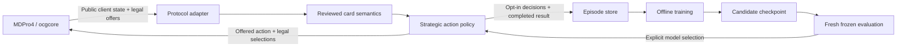

<div align="center">
  
  <h1>SKYNET</h1>
  <p><strong>Adaptive Duel Intelligence · MDPro4 AI Systems</strong></p>
  <p>Build a strategy. Change the deck. Learn from the duel.</p>
</div>

---

**SKYNET is an experimental, deck-independent duel AI for MDPro4.** It has its own
`SKYNET.exe`, solution, policy and learning tools. The project focuses on testing
and improving the AI's reliability, card coverage and playing strength across
different decks.

The first implementation is functional, with a deliberately bounded card library.
It is not yet a competitive general-purpose player or a trained neural model.

## Why a different AI

A deck-specific executor encodes one deck's route in ordered card handlers.
SKYNET instead compares the legal actions offered by the server using shared
card knowledge and strategic features. Changing a deck does not require a new
executor class. Knowledge added for a supported card is available to every deck.



The engine owns legality and resolution. SKYNET does not read an opponent's hidden
cards or assume it can execute a Lua effect in its head. The existing MDPro4 core
API has no state-clone primitive, so perfect lookahead is not silently assumed.

## What works now

| Capability | Current behavior |
| --- | --- |
| Arbitrary `.ydk` input | One policy, without a deck executor or prior deck training |
| Main-phase decisions | Rank all offered summons, sets, position changes, supported effects and phase exits |
| Chaining | Rank optional offers; always honor mandatory offers |
| Card selection | Select from actual server candidates using hint and the correct activation/resolution context |
| Basic combat | Reuses observed-state battle helpers |
| Strategy | Development, pressure, advantage, interaction, recovery, protection, conservation, risk and modest race cohesion |
| Learning | Optional softmax exploration; completed-duel episodes; offline linear residual updates |
| Frozen play | Greedy inference; no training-file writes or automatic checkpoint promotion |
| MDPro4 | Optional Windows external opponent through the ocgcore Solo adapter |

The bootstrap library covers Pot of Greed, Raigeki, Dark Hole, Monster Reborn,
Mystical Space Typhoon, Mirror Force, Trap Hole, Fissure, Smashing Ground,
Reinforcement of the Army and Sangan. Prompt timing was checked against local
`ygopro-scripts` sources. Mandatory selections do not depend on an activation
handler having run.

**Unfamiliar cards have limits.** Basic monster play can work, but unknown optional
effects are declined. General extra-deck procedure planning, complex combos and
unreviewed effect target/option choices are not solved. The included Vanguard
starter is an unrestricted research deck, not a current tournament-format deck.

## Build and run

Windows prerequisites: Visual Studio/MSBuild with .NET Framework 4.8 targeting
support. This is a classic C# project, not an SDK project. Python 3.11+ is needed
only for the development tools.

```powershell
msbuild Skynet.sln /t:Build /p:Configuration=Release /p:Platform="Any CPU"
.\bin\Release\SKYNET.exe --help
.\bin\Release\SKYNET.exe "DeckFile=Decks/AI_Skynet.ydk" `
  "DbPath=D:/YourGame/Data/locales/en-US/cards.cdb" `
  Host=127.0.0.1 Port=7911 Version=4962 Chat=false
```

The duel host must already be listening. Runtime databases and game scripts are
provided by the game and are not shipped in this repository. Missing input files
or a failed connection return a nonzero process exit code.

Useful options: `Name`, `DeckFile`, `DbPath`, `Host`, `Port`, `HostInfo`, `Version`,
`Hand`, `Debug`, `Chat`, `Config`, `PolicyModel`, `PolicyTraining`, `PolicyData`,
`PolicySeed`, and `PolicyGroup`. Chat is off by default. The optional `Deck=SKYNET`
argument used by MDPro4 identifies this policy; it does not select a legacy deck AI.

## Install into MDPro4

The game checkout needs the corresponding `SoloSelector.Skynet` host adapter and
its three call sites. The adapter source is mirrored in
[`Tools/Skynet/SoloSelector.Skynet.cs`](Tools/Skynet/SoloSelector.Skynet.cs).
This task installs those changes in the companion MDPro4 checkout; copying only
an executable into an older game build does not add the menu integration.

```powershell
.\Tools\Skynet\Install-MDPro4.ps1 -GameRoot 'D:/YourGame' -Configuration Release
```

This copies an explicit payload into `Data/Skynet`. Select **ocgcore**, then
**SKYNET** in Solo and choose the opponent's deck. The adapter uses the game's
locale database, disables training for normal play, and owns the exact external
process through completion, connection replacement, destruction and application
exit. It does not replace native Master Duel CPU behavior. Windows is the initial
integrated platform; other platform packaging remains future work.

## Can it teach itself?

It can learn **preferences among supported legal actions**. It does not learn new
card rules, target selection, battle tactics or combo procedures from these
weights. Those require richer representations and further implementation.

```powershell
# Collect completed episodes against a running duel host.
.\bin\Release\SKYNET.exe "DbPath=D:/YourGame/Data/locales/en-US/cards.cdb" `
  "DeckFile=Decks/AI_Skynet.ydk" Host=127.0.0.1 Port=7911 `
  PolicyTraining=true PolicyData=Training PolicySeed=42 `
  PolicyGroup=vanguard-vs-dragon

# After collecting varied deck/encounter cohorts from the SAME source model:
python Tools/Skynet/train.py --episodes Training --output Models/local/candidate-001.json

# Evaluate fresh matches with training disabled and PolicyModel=<candidate path>.
python Tools/Skynet/evaluate.py Artifacts/evaluation/results.csv
```

Training uses an episodic policy-gradient update over nine bounded features.
Checkpoint formats and features are validated; incomplete/disconnected duels do
not become losses. Each completed episode is published atomically under a unique
name. The offline trainer refuses mixed behavior-model versions, duplicate
records, invalid values and an empty training/holdout partition. Use stable,
distinct deck/encounter `PolicyGroup` values, not a different label for every duel.
Held-out groups do not contribute to the update. Candidate files never overwrite
a live checkpoint. Promotion is a separate, explicit choice after fresh frozen
duels; a small training win count is not evidence of improvement.

## Validation

```powershell
msbuild Tests/Skynet.Tests.csproj /p:Configuration=Debug
.\Tests\bin\Debug\Skynet.Tests.exe 'D:/YourGame/Data/locales/en-US/cards.cdb'
python Tools/Skynet/test_learning.py

python Tools/Skynet/native_smoke.py `
  --server 'D:/YourGame/Assets/Plugins/Windows/ygoserver.dll' `
  --data-root 'D:/YourGame/Data' --bot-exe bin/Release/SKYNET.exe `
  --deck Decks/AI_Skynet.ydk --opponent-deck Decks/AI_Skynet.ydk `
  --games 2 --output-dir Artifacts/qa/my-run
```

The native fixture requires an existing compatible Windows server DLL. It runs
isolated server/client processes with deadlines, records authoritative seats and
results, and checks normal retirement. It disables deck checks and shuffling for
a bounded smoke test. The core RNG seed is unavailable through this server API;
`PolicySeed` controls only policy sampling. Results with unknown core seeds are
reported as such, with independent match IDs.

Current checks: Debug and Release builds; 14 C# regression cases; 8 Python tests;
four prototype native duels, including supported effects and terminal training
records; two final Release starter duels with authoritative results and normal
exits; and 11 Unity host launch/connection-retirement assertions. The Unity
fixture preserved the checked settings and released its exact process. A separate
Play-session warning reported a common-menu sound loading timeout; the SKYNET
fixture itself logged no warnings or errors. These are correctness checks, not a strength benchmark.
Without a database, the C# harness explicitly skips its five card-backed cases.

## Testing and improvement roadmap

The next milestone is a repeatable benchmark with decision diagnostics. The
existing fixed-order native smoke test checks completion; repeating it many times
does not establish playing strength. The work below is planned, not implemented.

1. **Measure the baseline.** Freeze the current executable and policy. Add a
   manifest of small reviewed decks and compatible opponents, balance both seats,
   and record deck/core/script/model hashes. Keep fixed-order correctness fixtures
   separate from varied, shuffled strength matches. Record unavailable core seeds
   honestly rather than treating policy seeds as duel seeds.
2. **Explain mistakes.** Add optional diagnostic traces for offered actions,
   support/rejection reasons, scores, selected actions and selection prompts using
   only client-visible information. Report unsupported effect offers, timeouts,
   response failures, decision latency and completed results. Diagnostic capture
   must work independently of training; normal frozen play stays write-free.
3. **Improve shared card knowledge and tactics.** Expand reviewed effect
   capabilities, costs, targets and material selection in small coherent batches.
   Start with simple decks, then introduce extra-deck mechanics and short action
   sequences. Turn observed mistakes into focused regressions. Every deck should
   benefit from the same supported card knowledge without a new executor class.
4. **Evaluate each change.** Run the relevant regressions and the same declared
   matchup suite against a frozen baseline. Report results per matchup and seat,
   uncertainty, coverage and failures; do not hide failures in aggregate win rates.
   Use bounded pilot batches before larger runs and inspect representative duels
   in MDPro4.
5. **Train after the supported decisions are useful.** Collect diverse completed
   exploration episodes, keep deck/encounter groups separate, and evaluate each
   candidate in fresh frozen duels against multiple opponents. Promote only after
   evidence of improvement and no correctness regression. The current learner
   adjusts action preferences; learning new rules, target choices or combo plans
   requires further implementation.

Each completed update gets a descriptive commit and its actual validation
results. The project scope is the duel AI and its MDPro4 integration; an Expedition
mode, progression economy and campaign content are outside this roadmap.

## Project map

- `Game/AI/Strategy/`: SKYNET policy, shared semantics, learning session and adapter.
- `Game/SkynetDecisionAdapter.cs`: legal-offer integration and terminal lifecycle.
- `Game/`, `YGOSharp.*`: protocol and client-visible duel state.
- `Tools/Skynet/`: training, evaluation, native QA and MDPro4 installation.
- `Tests/`: dependency-free .NET Framework regression harness.
- `Branding/`: project logo, caption and application icon.

## Credits

SKYNET reuses WindBot/YGOSharp transport, state handling and general battle helpers;
the original MIT attribution is retained in [LICENSE](LICENSE). Its build contains
no legacy specialized deck-executor collection or BotWrapper launcher. The old
workspace copy is preserved locally outside the build and publication payload.

Branding follows the SKYNET artwork supplied by the project owner. The caption
was edited with the built-in ImageGen tool to read **ADAPTIVE DUEL INTELLIGENCE**
and **MDPRO4 AI SYSTEMS**. These branding assets are separate from the inherited
source-code license. No card database, native game DLL or proprietary game artwork
is included in the repository.
