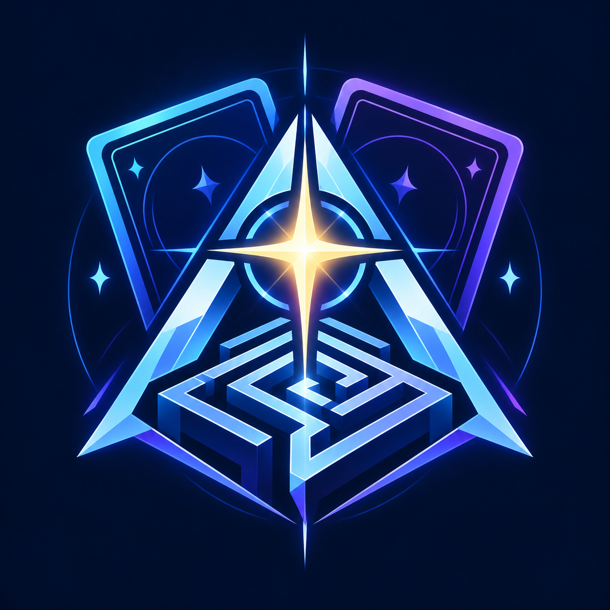

  
  <h1>Asterion</h1>
  
<strong>A new path for duel intelligence.</strong>

  
Deck-independent decision making for MDPro4 and the future Duel Expedition.

---

**Status: early implementation in progress.** This private repository is available
to its invited collaborators. It is not yet a release or a claim of competitive
performance.

Asterion is a new AI policy built on the WindBot protocol client. The goal is to
play changing decks without writing an entire executor for every deck, making
it useful for a single-player expedition where opponents and rewards evolve.

## The approach

1. **Let the game own the rules.** Rank only the legal actions offered by the
   server; use only information available to the bot's client.
2. **Share card knowledge across decks.** Small, reviewed card-effect semantics
   describe useful actions and selections without baking them into one deck's
   expansion route.
3. **Compare decisions.** A strategic policy evaluates development, pressure,
   interaction, resources and risk across the offered actions.
4. **Learn from completed duels.** Opt-in training records decisions and the
   authoritative result. Offline learning produces candidate weights; frozen
   evaluation measures them before promotion.
5. **Keep a working integration boundary.** Reuse the YGOPro transport and normal
   duels. MDPro4 will own an explicitly selected external bot process.

## What this does not promise

An unfamiliar deck is loadable before every unfamiliar effect is understood.
The first policy will use basic summons, battle and a small supported card
library; unknown optional effects are conservatively declined. Complex combos,
general Lua effect understanding, core-backed search, and strong self-play
training remain future work. Learning strategic weights does not automatically
teach the bot a new card's rules.

## Expedition direction

The intended game loop is starter deck -> route choice -> duel -> curated card
bundle -> deck revision -> themed boss, with saved runs and limited defeats.
This repository owns the AI foundation. The Expedition route UI, reward economy,
save format and game content belong to MDPro4 and are not implemented here yet.

## Development

The initial implementation retains C# and the existing .NET Framework 4.8 host
for compatibility. Python tools handle training and evaluation. Source,
build instructions, validated capabilities and integration instructions will
arrive in the following commits.

Updates use descriptive commit titles and bodies. An implementation commit
will distinguish successful builds, real duel checks, and remaining limitations.

## Heritage and license

Built on [WindBot](https://github.com/IceYGO/windbot) and its contributors'
YGOPro/YGOSharp protocol implementation. Existing attribution and the
[MIT license](LICENSE) are retained. The inherited executable name `WindBot.exe`
is kept for launcher compatibility; Asterion is the new policy/project identity.
Yu-Gi-Oh! card artwork, databases and game assets are not included as new project
branding or training data.

The original Asterion icon was generated with the built-in ImageGen tool:
a cyan/violet star, labyrinth and abstract card emblem on midnight navy.
